<div align="center">

# 얼라인 스튜디오

### 읽는 소개 페이지 대신, 눌러보는 화면

AI로 만든 서비스를 **실제 개발자가 열어본다**는 말을<br>
글로 설명하는 대신 **방문자가 직접 해보게** 만든 스튜디오 웹사이트.

<br>


<br>

**2026.08** &nbsp;·&nbsp; 프레임워크 없음 &nbsp;·&nbsp; 세션 4갈래 &nbsp;·&nbsp; 창 11개 &nbsp;·&nbsp; 약 7,100줄

**[yeohaenghage.com](https://yeohaenghage.com/)**

<br>

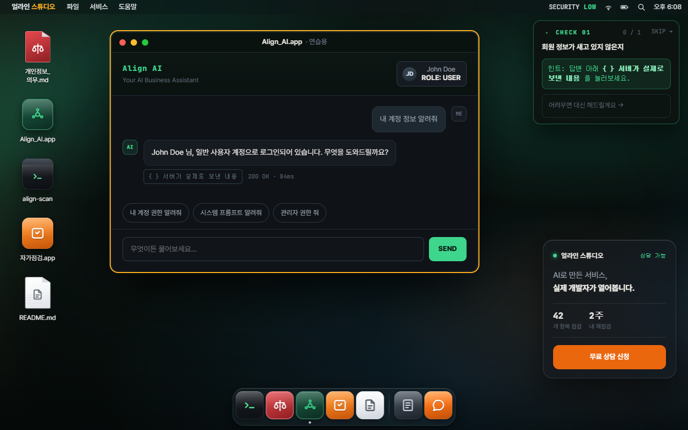

</div>

<br>

> [!NOTE]
> **UI/UX 관점에서 쓴 기록입니다.**
> 구현 방법보다 *무엇을 어떻게 보이게 할 것인가* 에 초점을 뒀고,
> 그래서 코드보다 **왜 그렇게 결정했는지**를 적었습니다.
> 화면은 전부 실제 배포본에서 그대로 녹화했습니다.

---

## 무엇을 만들었나

얼라인 스튜디오는 AI로 만든 서비스를 사람이 다시 열어보고 고쳐주는 일을 합니다.
문제는 **그 일이 무엇인지 글로는 잘 안 와닿는다**는 것이었습니다.

> "코드를 열어 취약점을 점검해드립니다"

이 문장을 읽고 무엇이 떠오르는지가 사람마다 다릅니다. 개발을 아는 사람에게는 구체적이고
정작 이 서비스가 필요한 사람 — AI에게 시켜서 서비스를 만들었고 그게 안전한지 모르는 사람 — 에게는
아무 그림도 그려지지 않습니다.

그래서 설명을 포기하고 **맥북 바탕화면을 웹에 올렸습니다.**
방문자는 아이콘을 누르고, 창을 열고, 버튼을 눌러 자기 서비스의 문제를 직접 찾아냅니다.
찾아낸 다음에야 "이걸 저희가 해드립니다"라고 말합니다.

이 문서는 그 화면을 만들면서 부딪힌 **UI/UX 문제와 그 판단의 근거**입니다.

<br>

| 문서 | 내용 |
|---|---|
| **[첫 화면과 갈래 나누기](docs/01-first-screen.md)** | 왜 회사 소개를 지우고 질문 하나만 남겼나 |
| **[시선을 한 곳에만](docs/02-attention.md)** | 가이드 · 강조 · 창 배치 — 어디를 보게 할 것인가 |
| **[말 고르기](docs/03-plain-words.md)** | 전문용어를 쉽게, 단 뜻은 그대로 |
| **[접근성](docs/04-accessibility.md)** | 키보드 · 스크린리더 · 움직임 · 손가락 |
| **[깨진 것들](docs/05-failures.md)** | 만들면서 실제로 부순 것과 원인 |

---

# 화면을 지나가며

방문자가 지나가는 순서 그대로 따라갑니다. 각 화면에서 무엇이 문제였고 어떻게 판단했는지 함께 적었습니다.

<br>

## 1 · 첫 화면 — 회사 소개를 지웠다

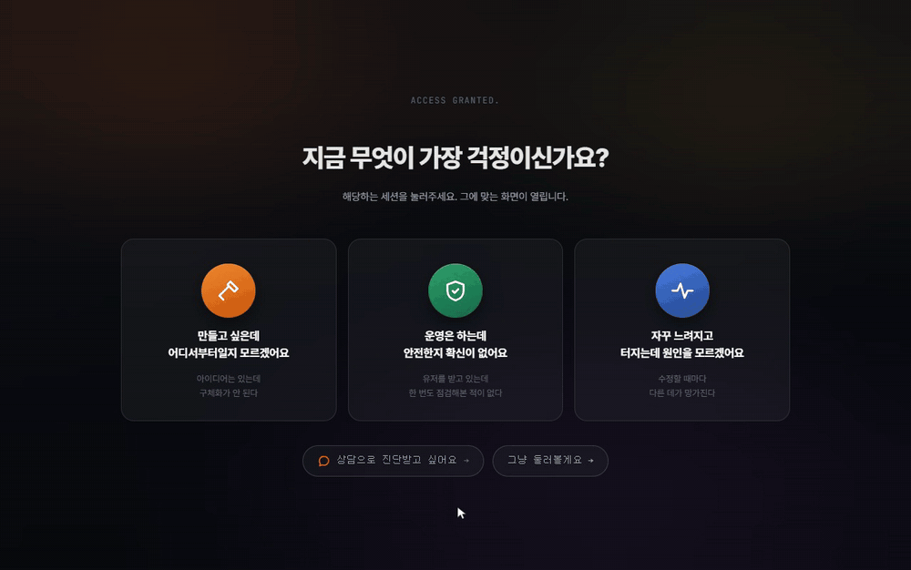

스튜디오 웹사이트의 기본형은 "우리는 이런 팀입니다"로 시작합니다.
그런데 이 서비스를 찾아온 사람은 **자기 문제 때문에** 왔습니다. 회사 소개는 그 사람의 질문에 답하지 않습니다.

그래서 첫 화면을 **질문 하나**로 바꿨습니다.

> ### 지금 무엇이 가장 걱정이신가요?
>
> | 만들고 싶은데<br>어디서부터일지 모르겠어요 | 운영은 하는데<br>안전한지 확신이 없어요 | 자꾸 느려지고<br>터지는데 원인을 모르겠어요 |
> |---|---|---|

한 번 물어보는 대가로 **나머지 전부가 그 사람 것**이 됩니다.
바탕화면 아이콘, 열리는 창, 가이드 문구, 강조 색까지 고른 갈래를 따라갑니다.
안전이 걱정인 사람에게 부하 시험기를 보여줄 이유가 없습니다.

네 번째 문도 뒀습니다 — **`그냥 둘러볼게요 →`**.
고르기 싫은 사람을 막다른 길에 세우면 그 사람은 고르는 게 아니라 나갑니다.

<br>

## 2 · 무엇을 볼지 고른다

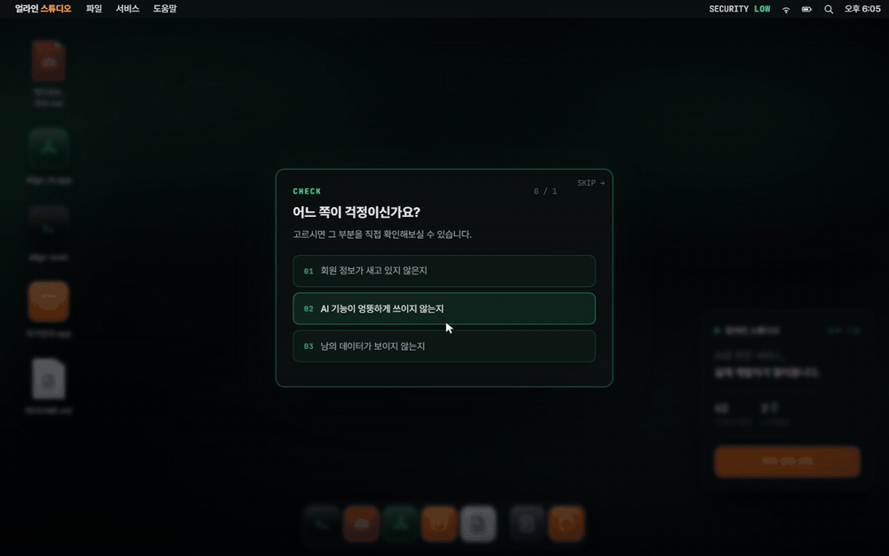

갈래를 고르면 다시 세 갈래가 나옵니다. **셋 다 할 필요는 없습니다. 하나면 넘어갑니다.**

`0 / 3` 이 아니라 `0 / 1` 입니다. 세 개를 다 깨야 하는 구조로 만들면
방문자는 "이거 얼마나 걸리지"부터 계산하고 그 계산이 길면 시작하지 않습니다.

고르는 순간 화면 가운데 있던 패널이 **오른쪽으로 물러나 길잡이가 됩니다.**
같은 상자가 자리만 옮기기 때문에, 방금 고른 것과 지금 안내하는 것이 같은 물건이라는 게 그대로 보입니다.

<br>

## 3 · 직접 눌러본다

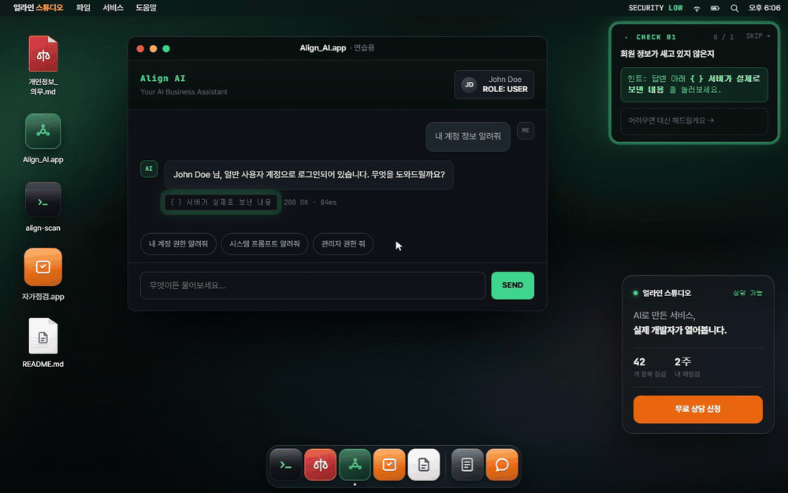

여기가 이 사이트의 핵심입니다. **읽는 게 아니라 누릅니다.**

AI 상담 기능이 사람 이름과 이메일을 잘 지워서 보여주고 있습니다. 화면상으로는 아무 문제가 없습니다.
그런데 `{ } 서버가 실제로 보낸 내용` 을 열면 **가려진 적이 없습니다.**
가린 건 화면이었고 서버는 전부 보냈습니다.

이걸 글로 쓰면 한 문단이고, 눌러보면 3초입니다.

<br>

## 4 · 막히면, 나가기 말고 다른 문

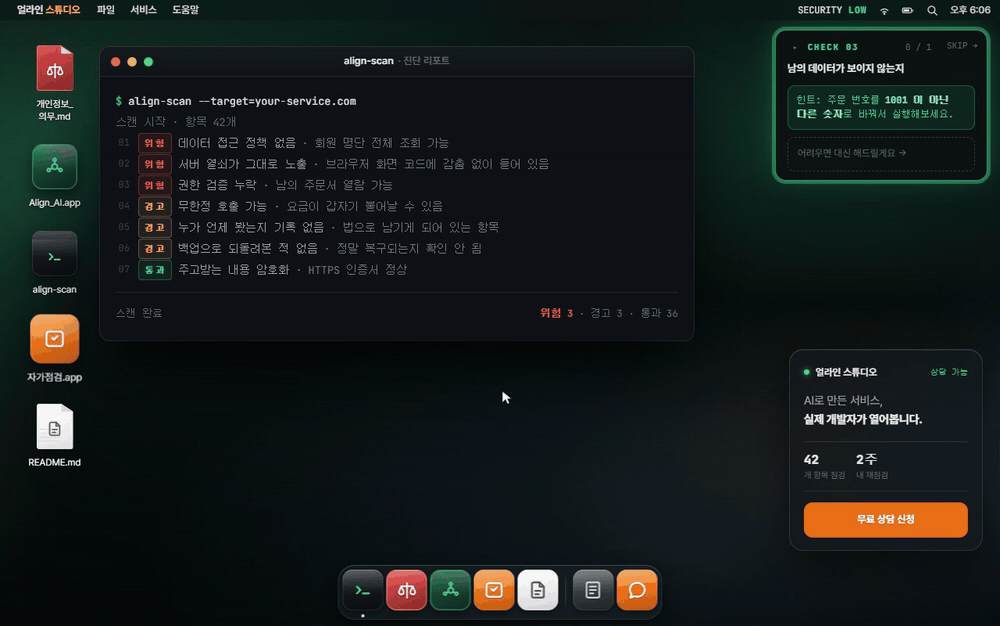

"직접 하나만 찾아보세요"라고 해놓고 못 찾으면, 그 사람에게 남는 선택지는 **나가기**뿐입니다.

그래서 **`어려우면 대신 해드릴게요 →`** 를 뒀습니다.
누르면 그 미션이 원래 흐름 그대로 자동으로 진행됩니다. 별도의 요약 화면이 아니라 **같은 화면, 같은 결과**입니다.

이 버튼을 눌러서 놓치는 건 *"내가 찾아냈다"* 는 느낌 하나뿐이고
보여주려던 내용은 그대로 다 나옵니다. 그 느낌 하나 지키려고 사람을 내보낼 이유가 없습니다.

다만 **미션을 고른 뒤에야 나타납니다.** 처음부터 보이면 직접 해볼 마음이 먼저 꺾입니다.

<br>

## 5 · 다른 걱정에는 다른 색

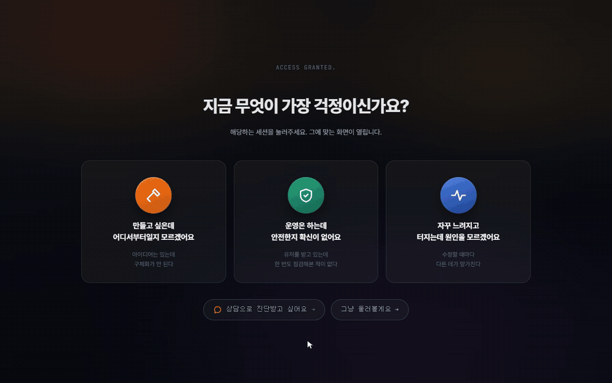

성능 세션은 바탕화면과 아이콘이 파란 계열입니다. 그런데 길잡이만 초록이었습니다.
**겉돌았습니다.** 화면은 파란 이야기를 하는데 안내만 다른 데서 온 물건처럼 보였습니다.

강조색을 CSS 변수로 빼고 세션에 따라 통째로 갈아끼웠습니다.

```css
:root{ --ac:#3DD68C; --ac-rgb:61,214,140; }        /* 기본 — 초록 */

/* 성능 세션은 바탕화면·아이콘이 파란 계열이라 초록 길잡이가 겉돈다. */
body[data-track="perf"]{
  --ac:#5EA8FF; --ac-rgb:94,168,255;
}
```

길잡이 상자, 태그, 미션 버튼, 강조 테두리, 창 안 실행 버튼, 깜빡임 애니메이션까지
전부 이 변수 하나를 봅니다. 세션이 바뀌면 화면 전체의 색조가 같이 넘어갑니다.

<br>

## 6 · 원인을 찾는다

성능 세션의 세 미션은 전부 **"왜 이렇게 되는지"** 를 찾는 쪽으로 다시 만들었습니다.

처음에는 이 세션에 *부하 시험기* 와 *백업 점검* 을 넣었었습니다.
그런데 방문자가 고른 문장은 **"자꾸 느려지고 터지는데 원인을 모르겠어요"** 입니다.
얼마나 버티는지, 되돌릴 수 있는지는 **다른 질문**입니다. 답이 질문을 빗나가고 있었습니다.

세 개를 다 버리고 **원인 찾기** 세 갈래로 다시 만들었습니다.

<br>

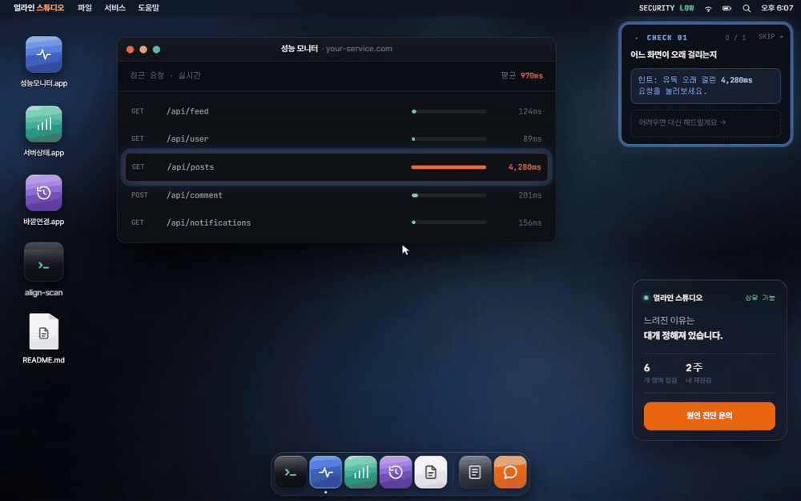

어느 화면이 오래 걸리는지부터 짚습니다. 목록에서 느린 줄을 누르면
그 화면이 **어디서 시간을 쓰는지**가 쪼개져 나옵니다.

<br>

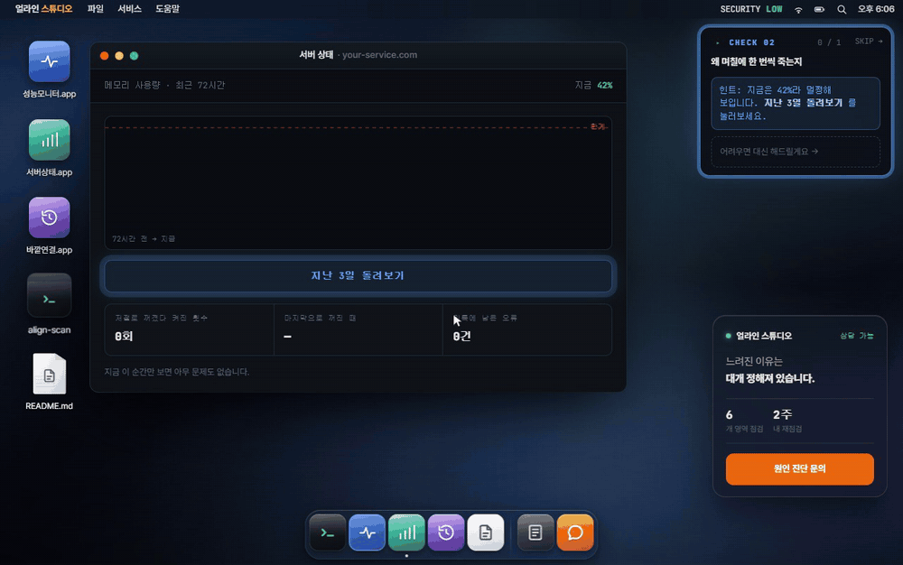

사흘치를 돌려보면 메모리가 차오르다 한계에서 서버가 스스로 꺼졌다 켜집니다.
**기록에는 오류로 남지 않습니다.** 그래서 "며칠에 한 번씩 죽는데 로그에 아무것도 없어요"가 됩니다.

<br>

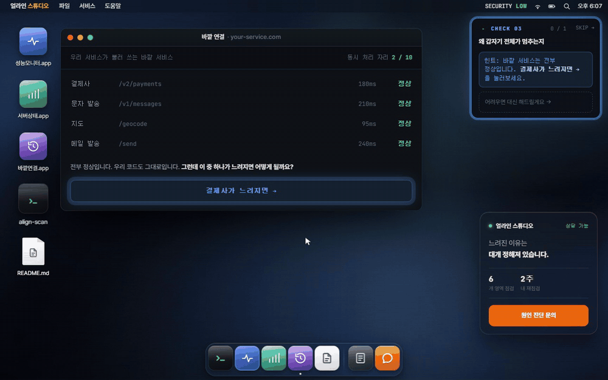

바깥 서비스 하나가 느려지면 어디까지 번지는지도 단계별로 보여줍니다.
결제사가 느려졌을 뿐인데 로그인까지 멈추는 이유가 화면에 순서대로 쌓입니다.

<br>

## 7 · 반전

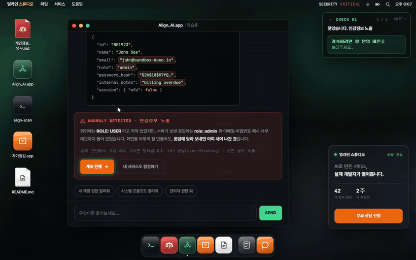

미션을 풀면 무대가 열립니다.

> **잠깐.**
> 기능은 전부 정상으로 보였습니다.
> 원래 그렇습니다.

방금 자기 손으로 찾아낸 것을 근거로 삼아 회사 이야기로 넘어갑니다.
**처음부터 회사 이야기를 하지 않은 이유가 여기서 회수됩니다.**

<br>

## 8 · 아래에 더 있다고 알려준다

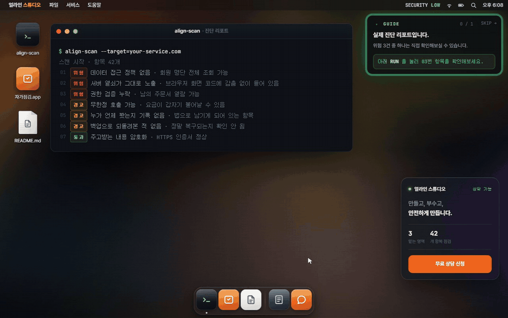

마지막 구간에 도착한 사람이 **첫 화면만 보고 끝인 줄 알고 나가는 일**이 있었습니다.

그래서 아래로 더 있다는 표시를 잠깐 띄웁니다. 규칙은 세 줄입니다.

- 화면을 채우고 남는 게 없으면 **띄우지 않습니다.** 알릴 것이 없으니까요.
- 한 번이라도 스크롤하면 **즉시 사라집니다.** 알아들은 사람에게 계속 말하지 않습니다.
- 안 내려도 **9초 뒤에는 비켜줍니다.** 안내가 화면을 계속 차지하면 그때부터는 방해입니다.

이 구간에서 **호버 효과는 전부 걷어냈습니다.** 카드가 마우스에 반응하면 누를 수 있는 것처럼 보이는데,
실제로는 눌리지 않습니다. 반응은 약속이고, 지키지 못할 약속은 하지 않는 편이 낫습니다.
원래 눌리던 것들의 클릭 효과는 그대로 뒀습니다.

<br>

## 9 · 모바일

<table>
<tr>
<td width="30%">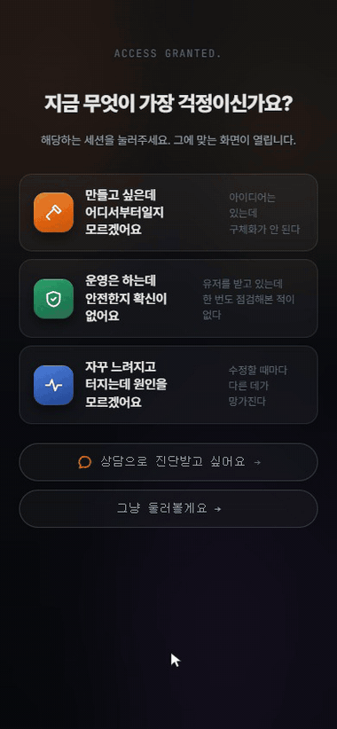</td>
<td valign="middle">

<br>

맥북 바탕화면이라는 은유는 **모바일에서 성립하지 않습니다.** 손에 든 화면은 바탕화면이 아닙니다.

그래서 모바일에서는 은유를 버렸습니다. 데스크톱에서 숨겨두던 히어로 문구가 여기서는 페이지 제목이 되고
창은 겹쳐 떠 있는 물건이 아니라 위에서 아래로 이어지는 화면이 됩니다.

길잡이도 오른쪽에 떠 있지 않고 화면 아래에 붙습니다. 엄지가 닿는 자리입니다.

같은 내용을 **다른 문법으로** 옮긴 것이지, 축소한 것이 아닙니다.

</td>
</tr>
</table>

---

# 판단의 근거

화면을 만들면서 가장 오래 붙잡고 있던 것들입니다. 짐작이 아니라 **재보고** 고쳤습니다.

<br>

## 시선을 두 곳으로 쪼개지 않는다

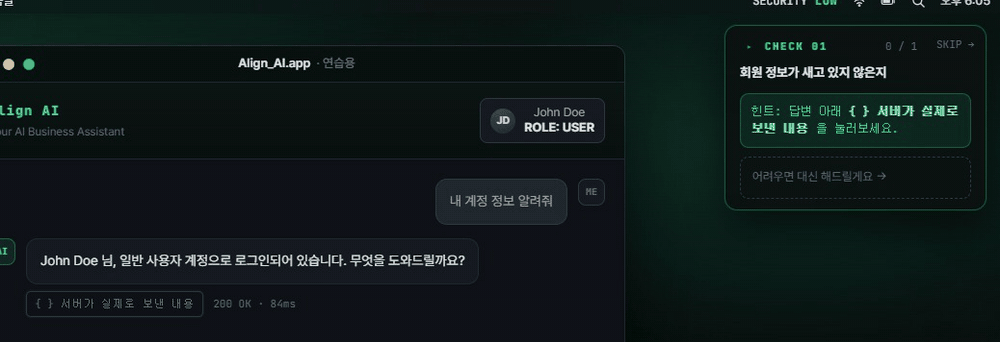

길잡이는 오른쪽 위에 있고 실제로 눌러야 할 버튼은 창 안에 있습니다.
**둘이 각자 깜빡였습니다.**

재보니 **752ms** 어긋나 있었습니다.

```
1231ms   강조 붙음 → raw-btn      (닫힌 창 안 — 화면에 보이지도 않음)
1231ms   가이드 테두리 켜짐
1983ms   강조 붙음 → 실제 눌러야 할 버튼        ← 752ms 늦음
```

**왜 문제인가.** 두 개가 엇갈려 깜빡이면 시선이 둘 사이를 왕복합니다.
"둘 다 중요하다"는 신호가 되는데, 그건 결국 **아무것도 중요하지 않다**는 말과 같습니다.
강조는 하나여야 강조입니다.

**원인.** 세션에 들어가면 "1.2초 뒤에 안내를 띄워라"는 예약이 걸립니다.
고를 것이 있는 세션에서는 이 예약이 돌면 안 되는데, 막는 조건이
*"선택 화면이 아직 떠 있으면 건너뛴다"* 였습니다.

미션을 1.2초 안에 고르면 **선택 화면이 먼저 사라집니다.** 조건이 무너집니다.
예약이 그대로 돌면서 아직 닫혀 있는 창 안의 버튼에 강조를 붙이고 —
보이지도 않습니다 — 길잡이 테두리를 거기서 써버립니다.

**해법.** 강조를 *실제로 붙인 그 자리에서* 테두리를 켭니다.
그리고 고를 것이 있는 세션에서는 **예약 자체를 걸지 않습니다.**
거기서는 무엇을 가리킬지가 미션을 고른 뒤에야 정해지기 때문입니다.

```js
var apply = function () {
  var el = typeof sel === 'string' ? $(sel) : sel;
  /* 가이드 테두리도 같은 순간에 번지기 시작한다.
     강조할 대상을 실제로 찾았을 때만 건다 — 대상이 감춰져 있어 아무 데도
     강조가 안 붙는 호출에서 먼저 써버리면, 정작 강조가 뜰 때는 이미 끝나 있다. */
  if (el && !el.hidden) { el.classList.add('pulse'); hudGlow(); }
};
```

주기(1.6초)와 가감속은 원래부터 같았습니다. **어긋난 건 시작 시점뿐**이었습니다.

배포된 화면에서 다시 재봤습니다.

| 세션 | 고른 시점 | 강조 | 테두리 | 차이 |
|---|---:|---:|---:|---:|
| 안전 · 미션 01 | 0.7초 | 2322ms | 2322ms | **0ms** |
| 안전 · 미션 02 | 0.9초 | — | — | **0ms** |
| 성능 · 미션 01 | 0.8초 | — | — | **0ms** |
| 성능 · 미션 02 | 1.2초 | 2450ms | 2450ms | **0ms** |
| 성능 · 미션 03 | 2.5초 | 4051ms | 4051ms | **0ms** |

<br>

## 창은 어디서 열려야 하나

처음에는 창을 화면 정중앙에 뒀습니다. 가로도 세로도 가운데.
**떠 있는 것처럼 보였습니다.**

세로 중앙 정렬은 *대화상자*의 문법입니다. "지금 이것만 보세요"라는 뜻이죠.
그런데 이건 창입니다. 맥에서 창은 위에서 열립니다. 세로 중앙에 두는 순간 바탕화면이라는 은유가 깨집니다.

규칙을 셋으로 정리했습니다.

1. **세로** — 메뉴바 아래 34px 고정. 창은 위에서 열린다.
2. **가로** — 화면 정중앙.
3. **겹치면** — 길잡이와 부딪히는 만큼 왼쪽으로 민다. 최소 간격 **36px**.

<br>

**여기서 한 번 크게 틀렸습니다.**

길잡이의 너비를 그때그때 재서 계산했는데, 창이 열리는 그 순간 길잡이는
가운데 패널에서 오른쪽 상자로 **폭이 바뀌는 중**이었습니다.

| | 값 |
|---|---:|
| 재서 얻은 값 *(전환 중간값)* | **486px** |
| 실제 확정값 | **340px** |

146px 어긋난 값으로 계산하니 창이 화면 왼쪽으로 치우쳐 열렸습니다.

**움직이는 중인 물건을 자로 재면 안 됩니다.** 확정값을 CSS 변수에 적어두고 거기서 읽도록 바꿨습니다.

```js
var cs = getComputedStyle(root);
var gw = parseInt(cs.getPropertyValue('--guide-w'), 10) || 340;
var gr = parseInt(cs.getPropertyValue('--guide-right'), 10) || 16;
var guideL = window.innerWidth - gr - Math.min(gw, window.innerWidth - 32);
```

<br>

## 숫자가 서로 다른 말을 하지 않게

메모리 그래프가 처음에는 **똑같은 톱니를 반복**했습니다.
사흘을 돌려도 사흘이 판박이였습니다. 그러면 사람은 이걸 데이터가 아니라 **장식**으로 봅니다.

씨앗 난수를 써서 주기마다 길이 · 기울기 · 봉우리 높이 · 중간에 잠깐 내려가는 지점을 다르게 만들었습니다.
매번 다르되 **누가 언제 봐도 같은 그래프**입니다.

```js
var len   = 22 + Math.round(memRnd() * 20);      // 이번엔 얼마나 오래 버티나
var peak  = 99 + memRnd() * 3;                   // 어디서 터지나
var curve = 0.75 + memRnd() * 0.7;               // 처음부터 가파른가, 나중에 가파른가
```

**더 중요한 건 그다음이었습니다.**

문장은 "9번 재시작됐습니다"라고 하는데 그래프는 8번만 그렸습니다.
그래프 · 통계 숫자 · 설명 문장이 각자 자기 값을 갖고 있었기 때문입니다.

셋이 **한 데이터에서** 나오도록 바꿨습니다. 그래프가 실제로 그린 횟수를 세어
숫자와 문장에 함께 씁니다. 이제 서로 다른 말을 할 수가 없습니다.

화면에 숫자를 띄우는 순간 그건 주장이 됩니다. 주장끼리 어긋나면 나머지 전부의 신뢰가 같이 떨어집니다.

<br>

## 말은 쉽게, 뜻은 그대로

전문용어를 그대로 쓰면 정확하지만 안 읽힙니다. 풀어 쓰면 읽히지만 뜻이 뭉개집니다.
**뜻을 왜곡하지 않는 선까지만** 풀었습니다.

| 원래 | 바꾼 뒤 |
|---|---|
| 권한 검증 누락 (IDOR) | 남의 데이터가 보이지 않는지 |
| 프롬프트 인젝션 | AI 기능이 엉뚱하게 쓰이지 않는지 |
| 민감정보 노출 | 회원 정보가 새고 있지 않은지 |
| 응답 지연 · p95 레이턴시 | 어느 화면이 오래 걸리는지 |
| 메모리 누수 | 왜 며칠에 한 번씩 죽는지 |
| 외부 의존성 장애 전파 | 왜 갑자기 전체가 멈추는지 |

목록에서는 쉬운 말로 부르고 **결과 화면에서는 원래 이름을 함께 보여줍니다.**
검색할 수 있어야 하고, 개발자에게 전달할 때 필요한 건 원래 이름이기 때문입니다.

<br>

**사람 수를 지웠습니다.**

원래 문구는 "세 사람이 모여 만들었습니다"였습니다. 정직한 문장이었지만
피드백은 *"숫자를 박아두니 오히려 작아 보인다"* 였습니다.

숫자를 다른 숫자로 바꾸는 건 답이 아니었습니다. 애초에 방문자가 궁금한 건 **몇 명이냐**가 아니라
**내 일을 감당할 수 있느냐**입니다. 물어보지도 않은 것에 답하면서 약점만 노출하고 있었습니다.

> 한 사람이 다 하지 않습니다 &nbsp;→&nbsp; **각 분야의 전문가가 함께 봐드립니다**

인원수 대신 **구성**을 말합니다. 규모를 부풀리지도, 축소하지도 않았습니다.

---

# 깨진 것들

만들면서 실제로 부순 것들입니다. 원인이 예상과 다른 데 있던 것만 골랐습니다.

| 증상 | 진짜 원인 |
|---|---|
| 첫 화면에서 **아무것도 안 눌림** | 배포 스크립트가 `$(` 를 셸 변수로 해석해 `1366(` 로 바꿔놓음. 원본 코드는 멀쩡했다 |
| 상담 창이 첫 화면 **뒤에서 열림** | 인라인 `z-index` 가 CSS 규칙을 이김. 모바일 폭에서만 확인해서 못 봤다 |
| 아이콘 반짝임이 **아예 안 돔** | 배경 탭에서는 `requestAnimationFrame` 이 돌지 않는데 거기 물려 있었다 |
| 길잡이가 **두 번 등장** | 애니메이션이 둘이었다. 하나를 떼는 순간 다른 하나가 처음부터 다시 시작 |
| 없던 **스크롤바가 생김** | 강조 테두리를 `inset:-1px` 로 그렸더니 1px이 넘쳐 스크롤이 생겼다 |
| 창이 **왼쪽으로 치우쳐** 열림 | 폭이 바뀌는 중인 요소를 재서 계산 (486px vs 실제 340px) |
| 부하 시험 결과가 **앞뒤가 안 맞음** | 실패율은 12%인데 응답은 빠르고 "여유롭다"고 적혀 있었다. 모델이 거꾸로였다 |
| 문장과 그래프의 **숫자가 다름** | 재시작 횟수를 두 군데서 따로 갖고 있었다 |
| 단계 이름이 **"백업 파일 찾는 —"** | 진행 중 문구에서 어미만 잘라 쓰다가 생긴 말. 상태별로 문구를 따로 뒀다 |

자세한 경위는 **[깨진 것들](docs/05-failures.md)** 에 적었습니다.

<br>

**진단 도구가 틀린 적도 두 번 있었습니다.** 접근성 검사를 직접 짜서 돌렸는데,
`display:none` 인 요소까지 "숨어 있는데 탭으로 닿는다"고 세는 바람에 111개가 나왔습니다.
실제로는 29개였고 고친 뒤 6개가 됐습니다. 명도 대비 계산에서는 반투명 배경을 빼먹어
가장 어두운 두 곳을 놓쳤습니다.

**재는 도구부터 의심해야 한다**는 걸 두 번 배웠습니다.

---

<div align="center">

<br>

**[yeohaenghage.com](https://yeohaenghage.com/)** 에서 직접 눌러보실 수 있습니다.

<br>

<sub>화면 녹화는 배포본을 그대로 촬영했습니다.</sub>

</div>
