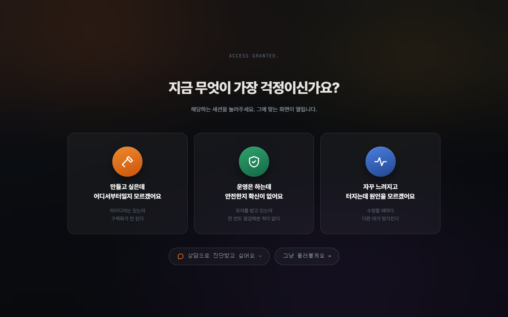

# 첫 화면과 갈래 나누기

> 왜 회사 소개를 지우고 질문 하나만 남겼나



---

## 문제

스튜디오 웹사이트의 기본형은 정해져 있습니다.

```
히어로 문구 → 우리가 하는 일 → 포트폴리오 → 팀 소개 → 문의하기
```

이 순서에는 전제가 하나 깔려 있습니다. **방문자가 이 회사를 궁금해한다**는 전제입니다.

그런데 이 사이트에 오는 사람은 그렇지 않습니다.
AI에게 시켜서 서비스를 만들었는데 그게 안전한지 몰라서 왔거나,
자꾸 느려지는데 원인을 못 찾아서 왔습니다. **자기 문제 때문에** 왔습니다.

그 사람에게 회사 소개를 먼저 보여주면, 자기 문제와 이 회사가 무슨 상관인지를
**방문자가 직접 연결해야 합니다.** 그 연결은 대개 일어나지 않습니다.

## 결정

첫 화면을 질문 하나로 바꿨습니다.

> ### 지금 무엇이 가장 걱정이신가요?
>
> 해당하는 세션을 눌러주세요. 그에 맞는 화면이 열립니다.
>
> | 만들고 싶은데<br>어디서부터일지 모르겠어요 | 운영은 하는데<br>안전한지 확신이 없어요 | 자꾸 느려지고<br>터지는데 원인을 모르겠어요 |
> |---|---|---|
> | 아이디어는 있는데<br>구체화가 안 된다 | 유저를 받고 있는데<br>한 번도 점검해본 적이 없다 | 수정할 때마다<br>다른 데가 망가진다 |
>
> 　　상담으로 진단받고 싶어요 →　　　그냥 둘러볼게요 →

각 카드에 **두 줄**을 넣었습니다. 위는 상태, 아래는 증상입니다.

위만 있으면 추상적입니다. "운영은 하는데 안전한지 확신이 없어요"는 누구나 해당됩니다.
아래 줄 — *"유저를 받고 있는데 한 번도 점검해본 적이 없다"* — 이 있어야
**"어, 내 얘기네"** 가 됩니다. 고르는 행동은 공감에서 나오지 분류에서 나오지 않습니다.

## 왜 이게 이득인가

한 번 물어보는 대가로 **나머지 전부가 그 사람 것**이 됩니다.

| 갈래를 고르면 | 바뀌는 것 |
|---|---|
| 바탕화면 아이콘 | 그 세션에 쓰는 것만 남는다 |
| 독(dock) | 마찬가지 |
| 열리는 창 | 고른 미션에 맞는 창만 |
| 길잡이 문구 | 세션마다 다른 말투와 목표 |
| 강조 색 | 세션의 바탕색과 맞춘 계열 |
| 메뉴바 상태 | `SECURITY LOW` → `CRITICAL` 로 바뀌는 시점도 세션마다 |

안전이 걱정인 사람에게 부하 시험기 아이콘을 보여줄 이유가 없습니다.
보여주면 그건 **"내 것이 아닌 화면"** 이 되고, 사이트 전체가 남의 이야기로 밀려납니다.

마크업에서는 이렇게 붙어 있습니다.

```html
<button class="dsk-ico" data-track="perf"   data-open="win-mem">서버상태.app</button>
<button class="dsk-ico" data-track="secure" data-open="win-law">개인정보_의무.md</button>
<button class="dsk-ico" data-track="secure perf guest" data-open="win-term">align-scan</button>
```

`data-track` 에 여러 갈래를 적어두면 그 갈래 전부에서 살아남습니다.
갈래마다 화면을 따로 만들지 않고 **한 벌로 다 덮습니다.**

## 네 번째 문

세 갈래 아래에 두 개를 더 뒀습니다.

- **`상담으로 진단받고 싶어요 →`** — 직접 해보고 싶지 않은 사람
- **`그냥 둘러볼게요 →`** — 고르고 싶지 않은 사람

고르기 싫은 사람을 막다른 길에 세우면 그 사람은 고르는 게 아니라 **나갑니다.**
선택을 강제하는 화면은 전환율을 올려주지 않습니다. 이탈을 만듭니다.

`둘러보기` 로 들어가면 미션 없이 화면만 구경합니다. 길잡이도 조용해집니다.
언제든 `SKIP →` 으로 마지막 구간으로 넘어갈 수 있습니다.

## 여기서 실제로 부순 것

첫 화면에서 **아무것도 안 눌리는** 일이 있었습니다.

원인은 화면이 아니라 배포 스크립트였습니다.
JavaScript 의 `$(...)` 를 셸이 변수로 해석해서 `1366(...)` 로 바꿔놓았습니다.
`1366` 은 그때 돌던 프로세스 번호였습니다. 원본 코드는 멀쩡했고, 배포본만 죽어 있었습니다.

그래서 빌드 스크립트에 검사를 하나 넣었습니다.

```powershell
# 숫자가 함수처럼 불리고 있으면 — $ 가 먹힌 것이다
$m = [regex]::Match($t, '(?<![\w.$])\d+\s*\(\s*[''"]')
if ($m.Success) { $fail += "숫자 호출: $($f.Name)" }
```

처음 만든 검사는 `.then(` 같은 정상적인 메서드 연결까지 잡아서 6건이 헛걸렸습니다.
**검사가 시끄러우면 아무도 안 봅니다.** 숫자가 함수 자리에 온 경우와 함수 이름이
통째로 사라진 경우만 남기고 좁혔습니다.

관련: [깨진 것들](05-failures.md)
