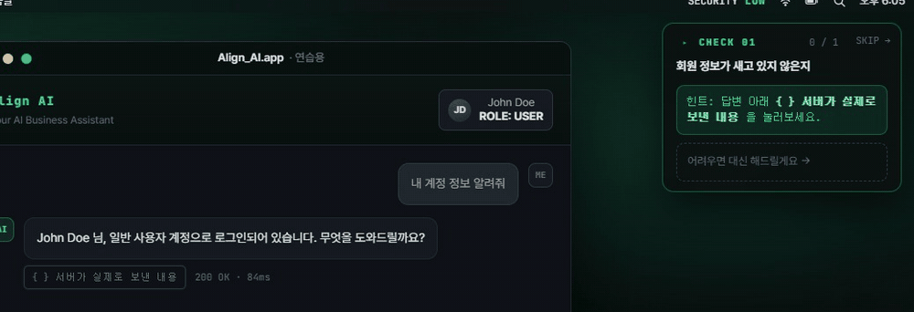
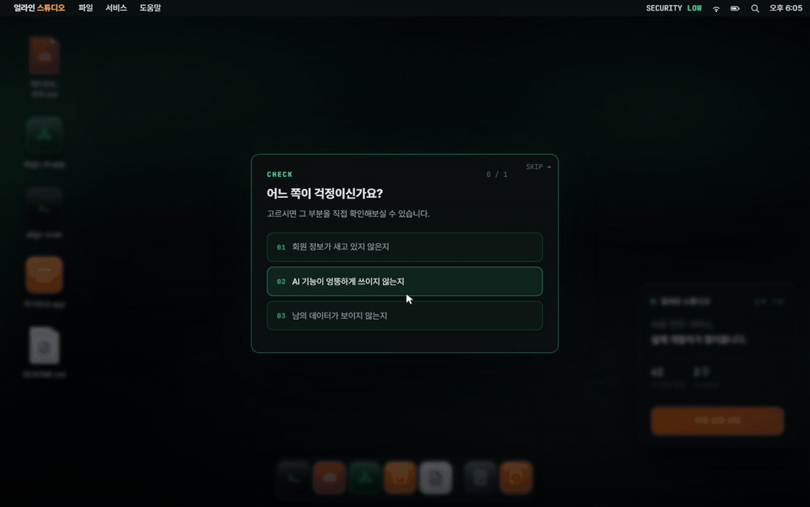

# 시선을 한 곳에만

> 가이드 · 강조 · 창 배치 — 어디를 보게 할 것인가



---

이 사이트는 방문자가 **직접 눌러야** 성립합니다. 안 누르면 아무 일도 일어나지 않습니다.
그래서 "지금 여기를 누르세요"를 어떻게 말하느냐가 화면 전체에서 가장 오래 붙잡은 문제였습니다.

말하는 방법은 셋입니다.

1. **길잡이** — 오른쪽에 뜨는 상자. 무엇을 왜 하는지 문장으로 알려준다
2. **강조** — 실제로 눌러야 할 버튼이 깜빡인다
3. **배치** — 창이 열리는 자리 자체가 시선을 옮긴다

셋이 서로 다른 말을 하면 아무 말도 안 한 것과 같습니다.

---

## 1 · 두 강조가 어긋나 있었다

길잡이는 오른쪽 위, 눌러야 할 버튼은 창 안. 둘 다 깜빡이는데 **박자가 달랐습니다.**

재보니 이랬습니다.

```
1231ms   강조 붙음 → raw-btn      (아직 닫혀 있는 창 안 — 화면에 보이지 않음)
1231ms   가이드 테두리 켜짐
1983ms   강조 붙음 → 실제 눌러야 할 버튼
                                          어긋남 752ms
```

### 왜 이게 문제인가

두 개가 엇갈려 깜빡이면 시선이 그 사이를 왕복합니다.
"둘 다 중요하다"는 신호가 되는데 그건 결국 **아무것도 중요하지 않다**는 말과 같습니다.

강조의 값어치는 *"여기 말고 다른 데는 아니다"* 에서 나옵니다.
두 군데가 동시에 손을 들면 그 값어치가 사라집니다.

같은 박자로 맞추면 반대가 됩니다. 두 개가 같이 밝아지는 순간
방문자는 그 둘을 **한 덩어리로** 읽습니다. *"저 설명이 이 버튼 얘기구나."*
길잡이와 버튼 사이를 눈으로 잇는 일을 화면이 대신 해주는 셈입니다.

### 원인

세션에 들어가면 "1.2초 뒤에 안내를 띄워라"는 예약이 걸립니다.
고를 것이 있는 세션(안전 · 성능)에서는 이 예약이 돌면 안 됩니다.
무엇을 가리킬지가 **미션을 고른 뒤에야** 정해지기 때문입니다.

막는 조건이 이랬습니다.

```js
if (solved || $('#hud').classList.contains('center')) return;   // ← 선택 화면이 떠 있으면 건너뛴다
```

미션을 **1.2초 안에** 고르면 선택 화면(`.center`)이 먼저 사라집니다. 조건이 무너집니다.

예약이 그대로 돌면서 안전 세션의 기본 대상인 `#raw-btn` 에 강조를 붙였습니다.
그 버튼은 아직 **닫혀 있는 창 안**에 있습니다. 화면에는 아무 변화가 없습니다.
그런데 길잡이 테두리는 거기서 이미 켜졌습니다. 테두리는 한 번만 도는 애니메이션이라
**정작 진짜 강조가 뜰 때는 쓸 것이 남아 있지 않았습니다.**

### 해법

두 가지를 같이 고쳤습니다.

**첫째, 테두리를 강조와 같은 자리에서 켭니다.**

```js
var apply = function () {
  var el = typeof sel === 'string' ? $(sel) : sel;
  /* 가이드 테두리도 같은 순간에 번지기 시작한다.
     강조할 대상을 실제로 찾았을 때만 건다 — 대상이 감춰져 있어 아무 데도
     강조가 안 붙는 호출에서 먼저 써버리면, 정작 강조가 뜰 때는 이미 끝나 있다. */
  if (el && !el.hidden) { el.classList.add('pulse'); hudGlow(); }
};
```

**둘째, 고를 것이 있는 세션에서는 예약 자체를 걸지 않습니다.**

```js
/* 고를 것이 있는 트랙(보안·성능)에서는 이 예약을 아예 걸지 않는다.
   거기서는 무엇을 가리킬지 미션을 고른 뒤에야 정해지기 때문이다. */
if (!pick) {
  setTimeout(function () { ... }, GUIDE_AFTER_OPEN);
}
```

*"화면이 아직 이 상태이면"* 으로 막는 대신 *"애초에 이 경우에는 걸지 않는다"* 로 바꿨습니다.
상태로 거르는 조건은 상태가 예상보다 빨리 변하면 무너집니다.

### CSS 쪽

주기와 가감속은 **처음부터 같았습니다.** 어긋난 건 시작 시점뿐이었습니다.

```css
.pulse        { animation: rawPulse 1.6s ease-in-out infinite; }
.hud.intro::after { animation: hudCall 1.6s ease-in-out 2; }   /* 지연 없음 — 시작은 JS가 잡는다 */
```

테두리를 `.hud` 본체가 아니라 `::after` 에 그린 데도 이유가 있습니다.
본체에 애니메이션을 걸면, 강조가 끝나 클래스를 떼는 순간 **등장 애니메이션이 처음부터 다시 돕니다.**
길잡이가 한 번 더 나타나는 것처럼 보였습니다. 등장과 강조를 다른 층으로 분리해서 끊었습니다.

### 재본 결과

배포본에서 다시 측정했습니다.

| 세션 | 미션을 고른 시점 | 강조 시작 | 테두리 시작 | 차이 |
|---|---:|---:|---:|---:|
| 안전 | 0.7초 | 2322ms | 2322ms | **0ms** |
| 안전 | 0.9초 | — | — | **0ms** |
| 성능 | 0.8초 | — | — | **0ms** |
| 성능 | 1.2초 | 2450ms | 2450ms | **0ms** |
| 성능 | 2.5초 | 4051ms | 4051ms | **0ms** |

---

## 2 · 창은 어디서 열려야 하나



처음에는 창을 화면 정중앙에 뒀습니다. 가로도 세로도 가운데.
**떠 있는 것처럼 보였습니다.**

세로 중앙 정렬은 *대화상자*의 문법입니다. "다른 건 됐고 지금 이것만 보세요"라는 뜻이죠.
그런데 이건 창입니다. 맥에서 창은 위에서 열립니다.
세로 중앙에 두는 순간 **바탕화면이라는 은유가 깨집니다.**

규칙을 셋으로 정리했습니다.

| | 규칙 | 이유 |
|---|---|---|
| 세로 | 메뉴바 아래 **34px** 고정 | 창은 위에서 열린다 |
| 가로 | 화면 **정중앙** | 처음 뜨는 것은 화면의 주인공이다 |
| 겹치면 | 길잡이를 피해 **왼쪽으로** · 최소 **36px** | 두 물건이 붙으면 하나로 보인다 |

간격 36px에는 근거가 있습니다. 이보다 좁으면 창과 길잡이가 **한 덩어리**로 읽힙니다.
길잡이는 창 밖에서 창을 가리키는 물건인데 붙어 있으면 창의 일부처럼 보입니다.

### 여기서 크게 틀렸다

길잡이의 너비를 **그때그때 재서** 계산했습니다. 그런데 창이 열리는 그 순간
길잡이는 가운데 선택 패널에서 오른쪽 상자로 **폭이 바뀌는 중**이었습니다.

| | 값 |
|---|---:|
| 재서 얻은 값 *(전환 중간값)* | **486px** |
| 실제 확정값 | **340px** |
| 차이 | 146px |

이 값으로 계산하니 창이 화면 왼쪽으로 치우쳐 열렸습니다.

**움직이는 중인 물건을 자로 재면 안 됩니다.**
확정값을 CSS 변수에 적어두고 거기서 읽도록 바꿨습니다.

```js
var cs = getComputedStyle(root);
var gw = parseInt(cs.getPropertyValue('--guide-w'), 10) || 340;
var gr = parseInt(cs.getPropertyValue('--guide-right'), 10) || 16;
var guideL = window.innerWidth - gr - Math.min(gw, window.innerWidth - 32);

if (overlapsY && x + wid > guideL - GUIDE_GAP) {
  x = Math.round(guideL - GUIDE_GAP - wid);
}
```

`--guide-w` 는 CSS가 좁은 화면에서 다시 정의합니다.
JS는 그 값을 **읽기만** 하므로 화면 폭에 따른 규칙이 두 곳에 흩어지지 않습니다.

---

## 3 · 등장 자체가 안내다

길잡이는 오른쪽 바깥에서 미끄러져 들어옵니다.

```css
body.guiding .hud { animation: hudSlideIn .68s var(--ease) .3s both; }
```

**0.3초 늦게 시작합니다.** 창이 먼저 자리를 잡은 다음에 길잡이가 옵니다.
동시에 나타나면 어디를 봐야 할지 두 개가 같이 손을 듭니다.
*창 → 길잡이* 순서를 만들어 시선의 차례를 정했습니다.

바탕화면 아이콘도 마찬가지입니다. 처음 들어오면 아이콘들이 왼쪽 위부터
차례로 한 번씩 밝아집니다. **3회 돌던 것을 2회로 줄이고 속도와 아이콘 사이 시차를 1.5배로 늘렸습니다.**

빠르게 세 번 반짝이면 *"오류인가?"* 로 읽힙니다. 느리게 두 번이면 *"여기 있습니다"* 로 읽힙니다.
같은 애니메이션인데 속도만으로 뜻이 바뀝니다.

---

## 4 · 강조를 걷어낸 자리

마지막 회사 소개 구간에서는 **호버 효과를 전부 걷어냈습니다.**

카드가 마우스에 반응하면 누를 수 있는 것처럼 보입니다. 그런데 그 카드들은 눌리지 않습니다.
반응은 약속이고 **지키지 못할 약속은 하지 않는 편이 낫습니다.**

원래 눌리던 것들 — 문의 버튼, 링크 — 의 클릭 효과는 그대로 뒀습니다.
"눌러도 아무 일 없음"을 확인시키는 것과 "눌리는 것만 반응함"은 다릅니다.
